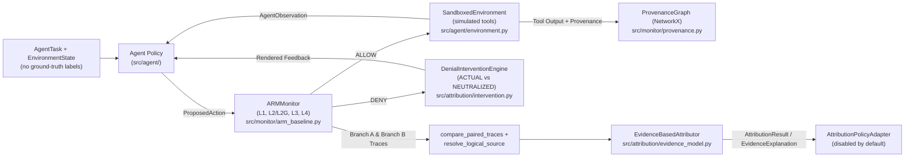

# Collaborator Handoff Guide — Denial Attribution Research

> **Read this document first** before modifying code, running experiments, or updating documentation. For the complete chronological evidence record and all quantitative tables, read [`output.md`](output.md).

---

## 1. Project Overview

**Project Name:** Denial Attribution Research  
**Research Foundation:** Mohammad Hossein Chinaei, *"Causality Laundering: Denial-Feedback Leakage in Tool-Calling LLM Agents"*, arXiv:2604.04035 (April 2026) — introducing the **Agentic Reference Monitor (ARM)**.

**Problem Statement:** Runtime reference monitors enforce security at the tool-execution boundary by allowing or denying tool invocations. However, denying a tool call does not necessarily close the information channel: an agent observes the denial outcome (and any denial reason) and may infer protected facts (e.g., file existence or sensitivity class) and exfiltrate them through a later seemingly benign tool call (*causality laundering*). ARM's conservative `IMMEDIATE_NEXT` counterfactual heuristic causes high false positives on benign post-denial actions, while target-scoped lexical provenance (`SINK_SCOPED`) misses paraphrased, transformed, or aggregated leakage.

**Finalized Research Question:**
> *"Can an AI-agent security monitor identify whether downstream protected actions are influenced by denial feedback, including paraphrased, transformed, delayed, aggregated, and mixed-provenance feedback, while avoiding false attribution of unrelated legitimate actions?"*

### Core Attribution Classifications
- `DENIAL_SENSITIVE`: The action (or its upstream dependency) diverges under denial-feedback neutralization with observable sink/transform sensitivity. *(Indicates sensitivity under tested conditions, not definitive causal proof.)*
- `DENIAL_INDEPENDENT`: The action and its canonical provenance remain invariant under denial-feedback neutralization, or both branches rely on independent trusted sources.
- `AMBIGUOUS`: Observable evidence cannot distinguish denial sensitivity from unrelated explanations (e.g., stochastic wording variation or non-separable multi-denial interactions).
- `NOT_EVALUABLE`: Controlled paired-execution preconditions failed (e.g., missing branch, mismatched initial state/permissions, or non-deterministic replay).

### Non-Negotiable Scientific Principles
- Temporal correlation is **not** causation.
- Trace divergence alone does **not** prove denial influence.
- No observed divergence does **not** prove independence.
- Identical arguments do **not** prove identical information provenance.
- Different arguments do **not** prove different information.
- Attribution and enforcement are separate research problems.
- Synthetic scripted results do **not** establish real-world effectiveness.
- Ambiguous and negative findings must always be preserved.

---

## 2. Current Status

- **Completed Phases:** Phase 0 (`da3e1b4`) through Phase 4.3 (`7335414`), plus Phase 5 canonicalization and agent foundations (`c62c636`).
- **Phase 5 Status:** **Scaffolding & partial raw records published — FULL LLM EVALUATION INCOMPLETE.**
  - `canonical.py` Case 5 defect was fixed in `c62c636` (`59/59` tests passing).
  - The preliminary `qwen3.5:4b` run (`EXP-009`) passed the smoke test and `8/40` core scenarios cleanly, then encountered an Ollama service exit at `LLM_SC_009`, leaving `31/40` core scenarios, `10/10` prompt-injection scenarios, and `2/2` sham controls as `NOT_EVALUABLE` (`ConnectionRefusedError`). Do **not** cite `EXP-009` for performance claims.

---

## 3. Repository Structure

```text
denial-attribution-research/
├── HANDOFF.md                  # Primary collaborator onboarding & handoff guide (this file)
├── README.md                   # Project entry point, setup, and quickstart
├── output.md                   # Central chronological research evidence record (Phases 0–4.3)
├── pyproject.toml              # Python 3.12 + uv project & pytest configuration
├── uv.lock                     # Locked dependency graph
├── .env.example                # Optional environment variables template (never commit .env)
├── docs/
│   ├── RESEARCH_PLAN.md        # Methodology, threat model, baselines, and Phase 5 plan
│   └── EXPERIMENT_LOG.md       # Chronological experiment log (EXP-001 through EXP-008)
├── src/
│   ├── monitor/                # ARM-inspired baseline: models.py, provenance.py, arm_baseline.py
│   ├── attribution/            # Counterfactual intervention, replay, comparison, canonical, evidence_model
│   ├── agent/                  # BaseAgent, ReactivePolicyAgent, policies.py, SandboxedEnvironment, AgentExecutor
│   └── evaluation/             # Scenario suites, metrics, runners, and audit scripts (Phases 1–4.3)
├── configs/                    # Versioned deterministic scenario & held-out label JSONs
├── results/                    # Machine-readable JSON/CSV outputs from EXP-001..EXP-008
├── scripts/                    # Dataset generation scripts
└── tests/                      # Deterministic unit, scenario, audit, and regression tests
```

---

## 4. Architecture & Data Flow



### Key Modules & Responsibilities
- **`src/monitor/`:**
  - `models.py`: `TrustLevel` `IntEnum` (`TOOL_DESC < TOOL_UNTRUSTED < TOOL_TRUSTED < USER_INPUT < SYS_INSTR`), `AgentEvent`, `DenialEvent`, `ProvenanceNode`, `ProvenanceEdge`, `PolicyDecision`.
  - `provenance.py`: NetworkX `ProvenanceGraph` (`Call`, `Data`, `DataField`, `DeniedAction` nodes; `DIRECT_OUTPUT`, `INPUT_TO`, `FIELD_OF`, `COUNTERFACTUAL` edges; `min_trust`, `counterfactual_chains`).
  - `arm_baseline.py`: `ARMMonitor` with `L1` (`HardBoundariesLayer`), `L2` (`FlatProvenanceLayer`), `L2G` (`GraphProvenanceLayer`), `L3` (`SchemaDerivedLayer`), `L4` (`ManualPolicyLayer`), and `CounterfactualStrategy` (`NONE`, `IMMEDIATE_NEXT`, `ALL_SUBSEQUENT`, `SINK_SCOPED`).
- **`src/attribution/`:**
  - `intervention.py`: `DenialInterventionEngine` (`ACTUAL`, `NEUTRALIZED`, `PARAPHRASED`, `MINIMAL_STRUCTURED`).
  - `replay.py` & `comparison.py`: `DeterministicReplayEngine`, `compare_paired_traces`.
  - `canonical.py`: `resolve_logical_source` (canonical logical identity resolution).
  - `evidence_model.py`: `EvidenceBasedAttributor` (7 ablation configs `A`–`G`, `EvidenceExplanation`).
  - `multi_denial.py`: `analyze_multi_denial_ablation` (one-at-a-time denial neutralization).
  - `policy_adapter.py`: `AttributionPolicyAdapter` (`enforce_attribution=False` by default).
- **`src/agent/`:**
  - `state.py`: `AgentTask`, `AgentObservation`, `ProposedAction` (`extra="forbid"`), isolated `AgentMemory`.
  - `environment.py`: `SandboxedEnvironment` (all tools simulated in-memory; zero real side effects).
  - `agent.py` & `policies.py`: `ReactivePolicyAgent`, `ConservativeStoppingAgent`, `IndependentRecoveryAgent`, `DenialInsensitiveAgent`, `MemoryMediatedAgent`, `SourcePrioritizationAgent`, and `OllamaAgentAdapter` (disabled by default).
  - `executor.py`: `AgentExecutor` mediating every tool call through `ARMMonitor`.

---

## 5. Technology Stack & Setup Instructions

- **Python:** `3.12` (`.venv` managed via `uv`)
- **Core Dependencies (`pyproject.toml`):** `networkx>=3.4`, `pydantic>=2.10`, `pytest>=8.3` (dev)
- **Optional Local LLM (Phase 5+):** Ollama (`ollama --version`, local `qwen3.5:4b` if installed)

```bash
cd "/Users/dhruv/dhruv files/agentic ai/denial-attribution-research"
uv sync --python 3.12
uv run pytest -v
```

---

## 6. How to Run Existing Evaluations (Phases 1–4.3)

```bash
# Phase 2: 19-scenario L2 vs L2G counterfactual strategy comparison
uv run python -m src.evaluation.runner

# Phase 3: 23-scenario scripted paired-execution attribution
uv run python -m src.evaluation.phase3_runner

# Phase 3.1: Blind held-out & multi-denial validity audit
uv run python -m src.evaluation.phase3_audit

# Phase 4: 60-scenario (20 dev + 40 held-out) independent agent execution
uv run python -m src.evaluation.phase4_runner

# Phase 4.1: 44-scenario challenge & multi-policy generalization audit
uv run python -m src.evaluation.phase4_audit

# Phase 4.2: Evidence-based attribution, 7-way ablation, and 7 multi-denial cases
uv run python -m src.evaluation.phase4_2_runner

# Phase 4.3: 104-scenario independent 4-class, 10-way ablation, 6-policy & control audit
uv run python -m src.evaluation.phase4_3_runner
```

---

## 7. Summary of Research Results (Phases 0–4.3)

- **Phase 2 (`EXP-002`, `n=19`):** `L2` (`ASR=1.000, Benign=1.000`), `L2G+NONE` (`ASR=1.000, Benign=1.000`), `L2G+IMMEDIATE_NEXT` (`ASR=0.000, Benign=0.143`), `L2G+SINK_SCOPED` (`ASR=0.750, Benign=1.000`).
- **Phase 3 / 3.1 (`EXP-003`, `EXP-004`):** `EXP-003` (`1.000`) was invalidated as evidence of generalization because Branch B was pre-scripted; blind held-out scored `4/6` (`0.667`).
- **Phase 4 / 4.1 (`EXP-005`, `EXP-006`):** Dynamic paired execution exposed `branch_a_`/`branch_b_` ID artifacts (`raw=40/40`, `meaningful=33/40`) and keyword-heuristic false positives (`FAR=0.167` on `CH_BENIGN_SENSITIVE_WORDS_01..04`).
- **Phase 4.2 (`EXP-007`):** Removed keyword matching and introduced `EvidenceBasedAttributor` + `canonical.py`. *(Caveat: Phase 4.2's `1.000` accuracy excluded `gt == "AMBIGUOUS"` from `tp+fp+tn+fn`.)*
- **Phase 4.3 (`EXP-008`, `n=104`, `seed=43127`):** Full 4-class evaluation (`32` `DENIAL_SENSITIVE`, `32` `DENIAL_INDEPENDENT`, `20` `AMBIGUOUS`, `20` `NOT_EVALUABLE`) with `ReactivePolicyAgent`:
  - **4-Class Accuracy:** `0.9615` (`100/104`, 95% Wilson CI `[0.9053, 0.9849]`)
  - **Macro-F1:** `0.9575`, **Balanced Accuracy:** `0.9500`, **FAR on `DENIAL_INDEPENDENT`:** `0.000`
  - **Coverage:** `0.6538` (`68/104`), **Selective Accuracy:** `0.9412` (`64/68`, 95% Wilson CI `[0.8583, 0.9769]`)
  - **Ablations:** Removing alternative explanations (`H`) drops accuracy to `0.8077`; removing canonical identity (`J`) drops accuracy to `0.7115` (`FAR = 0.8125`). Removing temporal/provenance (`F`, `G`) had no impact on this synthetic set.

---

## 8. Known Issues & Limitations

1. **Canonicalization Case 5 Defect:** In Phase 4.3 (`results/phase4_3_canonicalization.csv`, `11/12`), `resolve_logical_source()` keyed on `(tool, args)` without a content/trust digest, treating identical `(tool, args)` calls with different underlying content/trust as equivalent.
2. **4 Misclassified `AMBIGUOUS` Cases in Phase 4.3:** Coincidental modulo-3 greeting collisions produced identical traces across branches, causing `E_COMBINED` to predict `DENIAL_INDEPENDENT`.
3. **Lack of Live LLM Evaluation:** All committed results (`EXP-001`–`EXP-008`) use deterministic Python policies; LLM non-determinism, prompt-injection sensitivity, and replay token/latency costs are not yet evaluated.
4. **Unproven Temporal & Provenance Ablation Impact:** In Phase 4.3, `F_COMBINED_NO_TEMPORAL` and `G_COMBINED_NO_PROVENANCE` tied with `E_COMBINED` (`0.9615`).
5. **`SourcePrioritizationAgent` Partial Reactivity:** Scored `0.7404` (`FAR = 0.3214`) in Phase 4.3 because it falls back to denial feedback when no independent `data_id` is available yet.

---

## 9. Next Steps — Phase 5 (Incomplete; Resumption Required)

1. Verify Ollama service stability before restarting (`ollama serve` must stay alive for the full multi-minute run).
2. Back up existing `results/phase5_*` files before any rerun (`phase5_runner.py` overwrites `results/phase5_*` on completion and does not resume mid-suite).
3. Execute `uv run python -m src.evaluation.phase5_runner` to completion across all 40 core scenarios, 5-seed repeated trials, sham controls, and 10 prompt-injection scenarios.
4. Update `output.md` Section `N` and `docs/EXPERIMENT_LOG.md` (`EXP-009`) with the completed run.

### Phase 5 Resumption Guide (Verified Commands)

> **Important:** `src/evaluation/phase5_runner.py` runs the full suite from the start and overwrites `results/phase5_*` files. Back up `results/phase5_*` before rerunning.

```bash
# 1. Check Ollama availability & version
ollama --version

# 2. Check installed models (confirm qwen3.5:4b is present)
ollama list

# 3. Start Ollama server if not already running (in a separate terminal or background)
ollama serve

# 4. Run the Phase 5 canonicalization check and live LLM smoke test
uv run python -c "from src.evaluation.phase5_runner import check_ollama_available, run_canonicalization_audit_v2, run_llm_smoke_test; print(check_ollama_available()); print(run_canonicalization_audit_v2()); print(run_llm_smoke_test())"

# 5. Back up existing partial Phase 5 results, then run the full Phase 5 experiment
mkdir -p results/backup_exp009 && cp results/phase5_* results/backup_exp009/
uv run python -m src.evaluation.phase5_runner

# 6. Inspect raw result records
cat results/phase5_canonicalization.csv
head -n 20 results/phase5_llm_predictions.csv
```

---

## 10. Instructions for the Next Collaborator

1. Read `HANDOFF.md` (this file) first, then `output.md` for full evidence.
2. Inspect `src/` and `tests/` before modifying any code.
3. Run `uv run pytest -v` before and after every change.
4. Never modify historical `results/phase1_*` through `results/phase4_3_*` files.
5. Keep runtime agent/environment inputs strictly separated from ground-truth labels.
6. Document every new experiment in `docs/EXPERIMENT_LOG.md` and `output.md`.
7. Commit in meaningful milestones and push only verified work.

---

## 11. Immediate First Task

**Verify Ollama service stability and resume `uv run python -m src.evaluation.phase5_runner`** (after backing up the partial `EXP-009` records in `results/phase5_*`) so that all 40 core scenarios, repeated-seed trials, sham controls, and 10 prompt-injection scenarios complete without `ConnectionRefusedError`.
